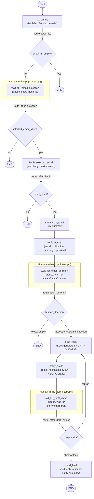

# Email HITL Agent

**Status:** open-source repository, not deployed. Gmail OAuth credentials (`credentials.json`, tokens) are git-ignored and must be supplied locally. The agent never sends an email without explicit human approval.

A human-in-the-loop (HITL) email agent built with LangGraph: it drafts email responses and pauses for approval, given via in-app buttons in the Streamlit UI, the Chrome extension's panel inside Gmail (through the local API), or the terminal script.

## Stack
- Streamlit (`app.py`) — approval UI
- LangGraph (`graph.py`, `nodes.py`, `state.py`) — agent workflow with interrupt/resume for human approval
- Gmail API (`gmail_helpers.py`, `auth_setup.py`) — reading and sending email
- `api.py` — backend API
- `extension/` — companion browser extension
- SQLite (`hitl_checkpoints.db`) — LangGraph checkpointing

## Architecture



The graph pauses at three `interrupt()` points (`wait_for_email_selection`, `wait_for_email_decision`, `wait_for_draft_choice`) using LangGraph's `SqliteSaver` checkpointer, so state persists across pauses and resumes. A paused run is resumed from Streamlit UI button clicks (`app.py`), from the Chrome extension's Gmail panel through the local API (`extension/` and `api.py`), or from the terminal script (`test_runner.py`). The notification emails are for reference only; replying to them does nothing.

## Run locally
Copy `.env.example` to `.env` and set `OPENAI_API_KEY`, `NOTIFY_EMAIL` (the address that receives the agent's notification emails) and `AGENT_EMAIL` (the agent Gmail account's own address). The app stops at startup with an error naming the variable if either address is missing.

```bash
pip install -r requirements.txt
streamlit run app.py
```

Requires Gmail API credentials (`credentials.json`) — not committed to this repo.
